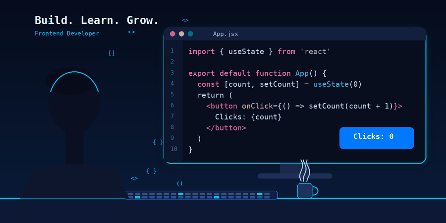

# Hi, I'm Iliya Mirzadeh 👋

Frontend Developer · React · Python · AI Enthusiast

## About Me

I'm a self-taught developer focused on building real-world web applications with React and modern JavaScript. I enjoy turning ideas into working products, learning new tools, and exploring how AI can improve the apps I build.

## Tech Stack

  
  
  
  
  
  
  
  
  
  

## Currently

- Building projects to grow my portfolio
- Learning full-stack development with Django

## Contact

<!--
**Iliyamirzadeh/Iliyamirzadeh** is a ✨ _special_ ✨ repository because its `README.md` (this file) appears on your GitHub profile.

Here are some ideas to get you started:

- 🔭 I’m currently working on ..
- 🌱 I’m currently learning ...
- 👯 I’m looking to collaborate on ...
- 🤔 I’m looking for help with ...
- 💬 Ask me about ...
- 📫 How to reach me: ...
- 😄 Pronouns: ...
- ⚡ Fun fact: ...
-->
